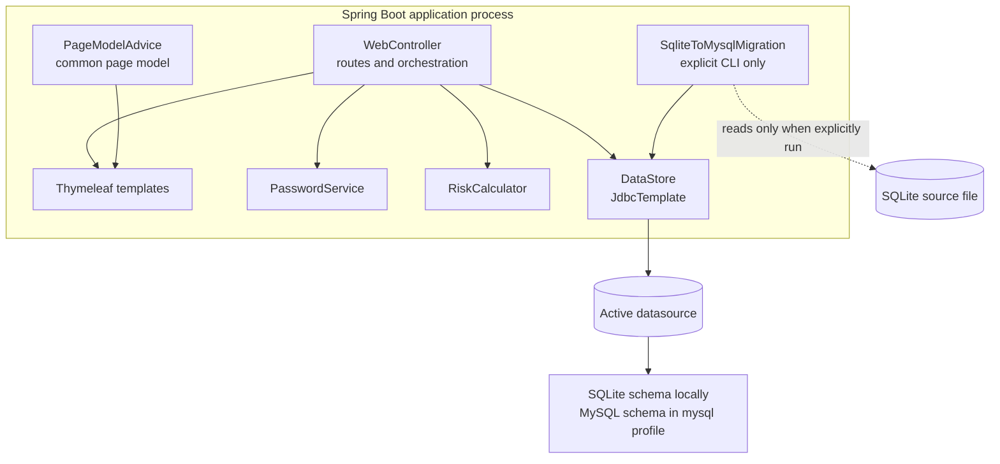
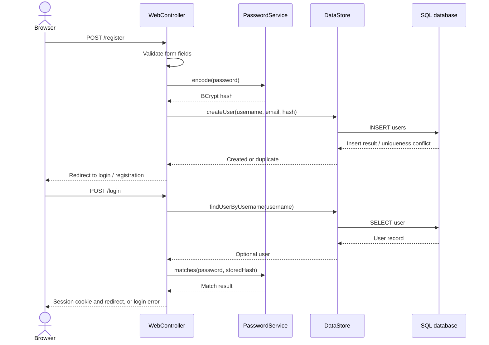
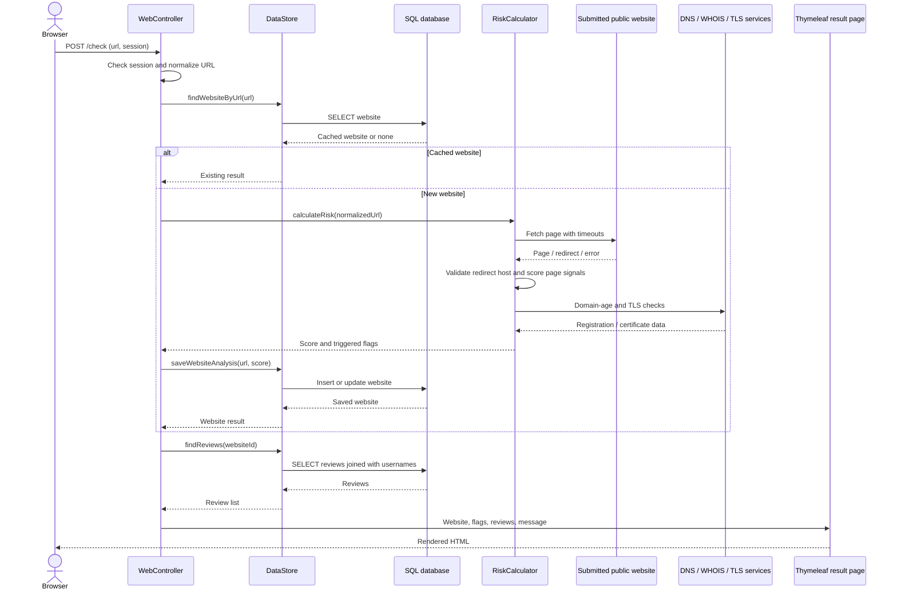
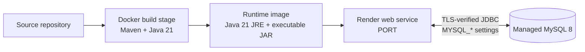

# Scam Flagger — Architecture

## System context

Scam Flagger is a server-rendered web application. A browser communicates with
the Spring Boot application over HTTP(S). The application stores accounts,
website analyses, and reviews in one configured SQL database. During website
analysis only, the application also makes outbound requests to the submitted
public website and domain/TLS information services.

```mermaid
flowchart LR
    User[User browser]
    App[Scam Flagger<br/>Spring Boot + Thymeleaf]
    DB[(Configured SQL database<br/>SQLite local / MySQL production)]
    Site[Public website]
    DNS[DNS and WHOIS services]
    TLS[Public TLS endpoint]

    User <-->|HTTP forms and rendered HTML| App
    App <-->|JDBC| DB
    App -->|Validated HTTP(S), redirects checked| Site
    App -->|Resolve host / query registration data| DNS
    App -->|Certificate check| TLS
```

The browser receives HTML pages; this repository does not define a separate
JSON API or a browser-to-database connection.

## Container and component view



`DataStore` is the database boundary used by HTTP request handling. The
migration runner is a separate, explicit startup mode: it reads the SQLite
source over SQLite JDBC and writes rows through the active MySQL
`JdbcTemplate`.

## Request and component interactions

### Registration and sign-in



The session stores the authenticated user ID and username. `/check` and
`/review` require a signed-in session. Logout invalidates that session.

### Website analysis



The analysis is synchronous within the request. The result score is capped at
100; a score of 70 or higher sets the persisted `flagged` state. A database
cache hit skips external analysis. Existing cached results do not include a
fresh set of triggered flags.

### Review submission

`POST /review` validates the active session, rating range, comment, and website
ID. `DataStore.createReview` inserts the row. The database foreign keys enforce
that referenced users and websites exist; the controller then redirects to
`GET /check?websiteId=...`, which loads the site and reviews for rendering.

## Runtime configuration and deployment



- `Dockerfile` compiles the project and packages the executable Spring Boot
  JAR into a Java 21 runtime image.
- `render.yaml` selects the `mysql` Spring profile and declares unsynced
  placeholders for sensitive MySQL connection values.
- `application.properties` is the local SQLite default and reads the HTTP
  port from `PORT`.
- `application-mysql.properties` selects MySQL, requires TLS identity
  verification, and selects the MySQL schema.
- `schema.sql` and `schema-mysql.sql` provide database-specific table
  definitions. Schema initialization is enabled at application startup.
- `.env.example` documents local MySQL variable names with placeholder values
  only. Do not put real credentials in this file or in source control.

The web application and SQL server are separate services. MySQL backups and
point-in-time recovery are responsibilities of the selected managed database
provider; the application does not dual-write a SQLite backup.

## SQLite-to-MySQL migration path

The normal web startup does not import data. To migrate, the operator first
backs up the SQLite file and provisions MySQL, then starts the application with
the `mysql` profile and `--app.migrate-sqlite-from=<path>`.

When that property is present, `ScamFlaggerApplication` disables the embedded
web server. `SqliteToMysqlMigration` validates the source path and schema
limits, reads users and websites before reviews, and writes batches to the MySQL
database inside a transaction. It preserves IDs, password hashes, comments,
and timestamps, and uses duplicate-key updates so a completed import can be
rerun. The source SQLite file is opened for reading and is not modified.

After migration, compare source and destination row counts for all three
tables, test login and reviews against MySQL, and only then deploy the regular
web process with MySQL configured.

## Operational and security considerations

- Keep the MySQL database private or network-restricted to the application
  host. Use a database user with access limited to the application's schema.
- Supply `MYSQL_PASSWORD` and any provider-specific secrets through the
  deployment secret manager, not committed files.
- Enable managed automated backups and point-in-time recovery, and periodically
  verify restore procedures.
- Website analysis makes outbound network requests. URL scheme, port, host
  resolution, and redirects are validated to restrict access to public web
  hosts; requests have timeouts.
- Session cookies are HTTP-only and configured with `SameSite=Lax`. Authentication
  is currently controller/session based, not a full Spring Security setup.
  Add Spring Security, CSRF tokens, and request rate limits before relying on
  the app for hostile public traffic.
- Password hashes are never rendered to the browser. New accounts use BCrypt;
  compatible legacy PBKDF2 hashes are verified to enable migration.
- Risk scores are heuristics, not proof of fraud. Preserve the explanation flags
  and avoid presenting the result as a definitive verdict.

## Source map

- Web routes and session flow: `src/main/java/com/scamflagger/WebController.java`
- Application entry point and migration-mode selection:
  `src/main/java/com/scamflagger/ScamFlaggerApplication.java`
- Database operations: `src/main/java/com/scamflagger/DataStore.java`
- Website fetching and scoring: `src/main/java/com/scamflagger/RiskCalculator.java`
- Password hash compatibility: `src/main/java/com/scamflagger/PasswordService.java`
- SQLite import: `src/main/java/com/scamflagger/SqliteToMysqlMigration.java`
- Templates: `src/main/resources/templates/`
- Database schemas: `src/main/resources/schema.sql` and
  `src/main/resources/schema-mysql.sql`
- Container and hosting configuration: `Dockerfile` and `render.yaml`
